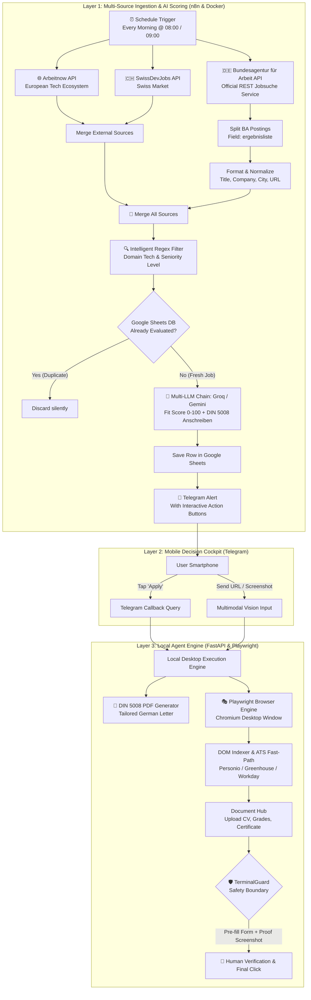

# 🚀 Titan Autonomous Job Hunter & AI Copilot

[](https://www.python.org/)
[](https://n8n.io/)
[](https://playwright.dev/)
[](https://fastapi.tiangolo.com/)
[](https://www.docker.com/)
[](LICENSE)

> **Autonomous End-to-End Job Search & Application Operating System for the DACH Market (Germany 🇩🇪, Switzerland 🇨🇭, Austria 🇦🇹 / Luxembourg 🇱🇺).**  
> Connects directly to official government and tech job APIs (**Bundesagentur für Arbeit**, **Arbeitnow**, **SwissDevJobs**), filters noise, performs semantic deduplication via Google Sheets, scores matching using multi-LLM chains (**Groq LLaMA 3.1 & Google Gemini**), drafts German cover letters following the **DIN 5008** standard, and triggers a mobile **Telegram Decision Cockpit** with a safe, local **Playwright** browser agent.

---

## 📑 Table of Contents

- [Architectural Overview](#-architectural-overview)
- [Key Features](#-key-features)
- [How It Works (Simplified for Everyone)](#-how-it-works-simplified-for-everyone)
- [Step-by-Step Installation Guide](#-step-by-step-installation-guide)
  - [1. Prerequisites](#1-prerequisites)
  - [2. Clone & Environment Setup](#2-clone--environment-setup)
  - [3. Configure Environment Variables (`.env`)](#3-configure-environment-variables-env)
  - [4. Configure Candidate Profile (`profil.json`) & PDFs](#4-configure-candidate-profile-profiljson--pdfs)
  - [5. Start n8n Orchestrator (Docker)](#5-start-n8n-orchestrator-docker)
  - [6. Import the Workflow Template](#6-import-the-workflow-template)
  - [7. Start the Telegram Cockpit](#7-start-the-telegram-cockpit)
- [How to Customize for Any Industry (Marketing, Finance, HR, Engineering)](#-how-to-customize-for-any-industry-marketing-finance-hr-engineering)
- [Safety & Guardrails (Human-in-the-Loop)](#-safety--guardrails-human-in-the-loop)
- [Project Structure](#-project-structure)
- [Security & Privacy FAQ](#-security--privacy-faq)
- [Author & Acknowledgments](#-author--acknowledgments)

---

## 🏛 Architectural Overview

The system operates across three decoupled layers: **Orchestration**, **Mobile Decision Cockpit**, and **Execution Agent**.



---

## ✨ Key Features

1. **Official Multi-Source Aggregation (No Fragile Scraping)**:
   - Integrates directly with the official German Federal Employment Agency (**Bundesagentur für Arbeit**) REST API (`/pc/v6/jobs`), **Arbeitnow**, and **SwissDevJobs**.
   - Retrieves daily fresh, verified postings without triggering anti-bot protections or CAPTCHAs.

2. **Smart Noise Elimination & Degree Safety Filter**:
   - Advanced Regex filtering eliminates >85% of irrelevant postings.
   - Enforces degree alignment: automatically rejects high-school level vocational apprenticeships (*Ausbildung / Azubi*) and Bachelor-level dual study programs when targeting Junior, Graduate, Working Student (*Werkstudent*), or Master-level positions.

3. **Zero-Duplicate Idempotency**:
   - Uses your personal **Google Sheet** as a persistent ledger. If an offer has already been retrieved in previous days, it is discarded immediately before invoking LLM APIs, saving tokens and eliminating duplicate notifications.

4. **Strategic AI Scoring & DIN 5008 German Cover Letters**:
   - Multi-LLM chain (Groq LLaMA 3.1 with Google Gemini fallback) objectively evaluates applicant-offer fit from 0 to 100%.
   - When score $\ge 60$, it formats a complete German cover letter (*Anschreiben*) conforming to the German business standard **DIN 5008**, strictly grounded in your verified experience (`profil.json`) with zero hallucinations.

5. **Mobile Telegram Decision Cockpit**:
   - Receive notifications on your phone with instant action buttons: `[ 🚀 POSTULER SUR MON ÉCRAN ]`, `[ ❌ IGNORER ]`, `[ 🌐 VOIR L'OFFRE ]`.
   - **Multimodal ingestion**: Share any LinkedIn post, website URL, or screenshot from your mobile to your Telegram bot; the bot extracts details and generates a personalized application.

6. **Playwright Browser Agent with Human-in-the-Loop Safeguard**:
   - Opens Chromium on your desktop, detects ATS structures (Personio, Workday, Greenhouse, etc.), and pre-fills all personal fields, questionnaires, and document uploads.
   - **`TerminalGuard` Safety Guarantee**: Strictly halts before clicking the final submit button (*"Bewerbung abschicken" / "Submit"*). You remain in total control to review the application and click send.

---

## 💡 How It Works (Simplified for Everyone)

Even if you have never written a line of code, this project is designed to act as your **personal job assistant**:

1. **Every morning at 09:00**, the robot searches job portals for newly posted jobs matching your criteria.
2. It **checks your spreadsheet** so you never see the same job twice.
3. An **artificial intelligence reads the job description**, scores how well it fits your background, and writes a tailored German cover letter.
4. It sends a message to **your Telegram app on your phone** with the summary and cover letter.
5. You click **"Apply"** on your phone, and the robot opens your computer browser, fills out the repetitive application form for you, and stops right before the final send button so you can verify everything.

---

## 🚀 Step-by-Step Installation Guide

### 1. Prerequisites

You only need two free tools installed on your computer:
- **Docker Desktop** ([Download here](https://www.docker.com/products/docker-desktop/)) — Runs the n8n automation engine.
- **Python 3.10 or higher** ([Download here](https://www.python.org/downloads/)) — Runs the Telegram bot and browser assistant.
- A **Telegram account** on your smartphone.

---

### 2. Clone & Environment Setup

Open PowerShell (Windows) or Terminal (macOS/Linux) and run:

```bash
# 1. Clone this repository
git clone https://github.com/FRAID0/JOB-HUNTER-N8N.git
cd JOB-HUNTER-N8N

# 2. Create a Python virtual environment
python -m venv venv

# 3. Activate the virtual environment
# On Windows:
.\venv\Scripts\activate
# On Linux / macOS:
source venv/bin/activate

# 4. Install dependencies and Playwright browser
pip install -r requirements.txt
playwright install chromium
```

---

### 3. Configure Environment Variables (`.env`)

Copy the example configuration file:

```bash
# On Windows:
copy .env.example .env
# On Linux / macOS:
cp .env.example .env
```

Open `.env` in any text editor (Notepad, VS Code) and fill in your values:

```ini
# 1. Telegram Bot Token:
# Open Telegram, search for @BotFather, type /newbot, follow the prompts, and copy the token.
TELEGRAM_BOT_TOKEN=1234567890:ABCdefGhIJKlmNoPQRstuVWXyz

# 2. Your Telegram Chat ID:
# Search for @userinfobot on Telegram, click Start, and copy your ID number.
TELEGRAM_CHAT_ID=123456789

# 3. Free Google Gemini API Key:
# Get a free key at https://aistudio.google.com/
GEMINI_API_KEY=AIzaSyYourGeminiApiKeyHere

# 4. (Optional) Personal overrides
CANDIDATE_EMAIL=your.email@example.com
CANDIDATE_PHONE=+49 151 00000000
LINKEDIN_URL=https://www.linkedin.com/in/your-profile
```

---

### 4. Configure Candidate Profile (`profil.json`) & PDFs

1. Copy the template profile:
   ```bash
   copy profil.example.json profil.json
   ```
2. Open `profil.json` and adjust your name, address, degree, skills, and languages.
3. Put your resume into the `documents/` folder:
   - `documents/cv.pdf` *(Your Resume / Lebenslauf)*
   - *(Optional)* `documents/notenspiegel.pdf` *(Grades)*
   - *(Optional)* `documents/zeugnisse.pdf` *(Certificates)*

---

### 5. Start n8n Orchestrator (Docker)

Make sure Docker Desktop is running, then run:

```bash
docker compose up -d
```

Open your browser and navigate to **`http://localhost:5678`**. Set up your admin account on the first launch.

---

### 6. Import the Workflow Template

1. In your n8n browser interface, click the **`...`** (menu in the top right corner) $\to$ **Import from File...**
2. Choose **`workflow_job_hunter.example.json`** from this project directory.
3. In n8n, connect your free credentials:
   - **Google Sheets OAuth2**: Connect your Google account and link a blank Google Sheet named `Job_Hunter_DB` with columns: `ID_Lien`, `Date`, `Entreprise`, `Poste`, `Statut`, `Score_IA`, `Lettre_Motivation`.
   - **Groq API** or **Google Gemini API**: Enter your free API key in the chat model node.
4. Click **Save** and toggle the workflow to **Active / Published**.

---

### 7. Start the Telegram Cockpit

Whenever you want the assistant active on your PC, simply double-click:

- **`lancer_cockpit.bat`** (on Windows)  
  *Or run in terminal:* `python telegram_cockpit.py`

Your terminal will display:
```text
=================================================================
🤖 COCKPIT TELEGRAM UNIVERSEL (100% ACTIF)
👤 Candidat    : [Your Name]
🤖 Bot connecte: @YourBot (JOB HUNTER)
=================================================================
```

You are ready! Every morning, you will receive tailored opportunities on Telegram.

---

## 🎯 How to Customize for ANY Industry (Marketing, Finance, HR, Engineering)

This system is not limited to software engineering! You can adapt it to **any career path** in 3 simple adjustments:

### Step 1: Change Search Term in the Bundesagentur Node
In n8n, double-click the **`JOB Bundesagentur für Arbeit`** node:
- In the `was` query parameter, replace `Informatik` with your target profession:
  - **Marketing**: `Marketing Manager`, `Content Creator`, `Social Media`
  - **Finance / Accounting**: `Buchhaltung`, `Finanzen`, `Controlling`
  - **Human Resources**: `Personalwesen`, `HR Manager`, `Recruiter`
  - **Mechanical Engineering**: `Maschinenbau`, `Konstrukteur`, `CAD`
  - **Logistics**: `Logistik`, `Supply Chain`, `Spedition`

### Step 2: Adjust Title Filtering in the `Filter` Node
In n8n, double-click the **`Filter`** node:
- **Condition 1 (Seniority)**: Keep `junior|werkstudent|praktik|intern|trainee|entry|absolvent|master` or modify for your level.
- **Condition 2 (Field Keywords)**: Replace the developer keywords (`developer|python|...`) with keywords from your sector (e.g. `marketing|content|brand|pr` or `buchhalter|controlling|finance`).
- **Condition 3 (Exclusions)**: Keep unwanted titles like `senior|lead|head|director`.

### Step 3: Update Profile in `profil.json` & the LLM Prompt
- In `profil.json`, list your real diplomas, tools (e.g. SAP, Excel, Canva, Salesforce, AutoCAD), and languages.
- In n8n, open **`Basic LLM Chain`** and replace the bullet points under `BEWERBERPROFIL` with your own background. The AI will immediately draft perfect DIN 5008 cover letters adapted to your industry!

---

## 🛡 Safety & Guardrails (Human-in-the-Loop)

Job applications represent your professional reputation. This project enforces strict ethical and technical boundaries:

1. **`TerminalGuard` (Anti-Submit Protection)**:
   - The browser agent fills text fields, uploads resumes, and clicks multi-step *"Next"* buttons.
   - It **strictly intercepts** final submit buttons (*"Bewerbung abschicken"*, *"Submit application"*, *"Kostenpflichtig bestellen"*). It **refuses** to click them automatically.
2. **Visual Proof & Full Transparency**:
   - Chromium runs visibly on your screen (`headless=False`).
   - A full-page high-resolution screenshot is captured in `documents/screenshots/`.
   - You have a live inspection window to review the pre-filled form and click the final submit button yourself.
3. **No Hallucinations**:
   - The LLM prompt is strictly bounded to the candidate's verified facts (`profil.json`). If a technology or past experience is not in the profile, the AI cannot invent it.

---

## 📂 Project Structure

```text
JOB-HUNTER-N8N/
├── agent_engine/               # Autonomous Browser Agent Core
│   ├── action_schema.py        # Pydantic schemas for browser actions
│   ├── action_validator.py     # Action sanity and boundary validation
│   ├── agent_loop.py           # Perception-reasoning-action loop
│   ├── candidate_knowledge.py  # Structured candidate facts lookup
│   ├── document_hub.py         # File attachment resolver (CV, grades)
│   ├── dom_indexer.py          # Interactive DOM accessibility indexer
│   ├── executor.py             # Playwright action executor
│   ├── fast_path.py            # ATS heuristics (Personio, Greenhouse, Workday)
│   ├── llm_decider.py          # Multimodal decision engine
│   ├── state_machine.py        # Application progress state tracking
│   └── terminal_guard.py       # Strict Human-in-the-Loop submit interceptor
├── documents/                  # Candidate documents & runtime screenshots
├── tests/                      # Automated unit & integration tests
├── .env.example                # Environment variables template (No secrets)
├── docker-compose.yml          # n8n container definition
├── workflow_job_hunter.example.json # Public clean n8n workflow template
├── profil.example.json         # Candidate profile structure template
├── requirements.txt            # Python dependencies
├── telegram_cockpit.py         # Real-time Telegram bot & multimodal parser
├── copilot_apply.py            # Primary Playwright application copilot
├── lancer_cockpit.bat          # 1-Click launcher for Telegram Cockpit
├── demarrer_worker.bat         # 1-Click launcher for FastAPI worker
└── lancer_copilote.bat         # 1-Click launcher for manual CLI copilot
```

---

## 🔒 Security & Privacy FAQ

- **Are my API keys, phone number, or resumes uploaded anywhere?**  
  **No.** This system runs **100% locally** on your own computer. The `.gitignore` is strictly configured to ensure `.env`, `profil.json`, client credentials, and `documents/*.pdf` are never tracked by Git.
- **Is this web scraping permitted?**  
  Yes. The primary source uses the **Bundesagentur für Arbeit**'s official REST API, and Arbeitnow/SwissDevJobs provide official open endpoints. No unauthorized scraping of login-protected areas is performed.

---

## 👨‍💻 Author & Acknowledgments

Created by **Wilfried Manfouo Fomekong (Fraid)**  
*Student of Applied Computer Science (B.Sc.) @ Hochschule Worms*  
*Focus: Cloud Architecture, DevOps, Backend Systems & Autonomous AI Agents.*

- **Portfolio**: [portfolio-pro-fraid.vercel.app](https://portfolio-pro-fraid.vercel.app/de)
- **Deep-Dive Article**: [Vom Bewerbungs-Burnout zum autonomen AI-Copiloten](https://portfolio-pro-fraid.vercel.app/de/blog/vom-bewerbungs-burnout-zum-autonomen-ai-copiloten)
- **GitHub**: [@FRAID0](https://github.com/FRAID0)
- **LinkedIn**: [Wilfried Manfouo Fomekong](https://www.linkedin.com/in/wilfried-manfouo-fomekong)

---

### ⚖️ License

Distributed under the **MIT License**. See `LICENSE` for details.
