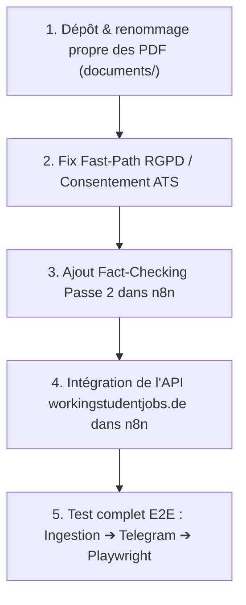

# 🗺️ Feuille de Route & Cahier des Charges : Autonomous Job Hunter OS

> **Projet :** Système d'automatisation des candidatures tech (DACH : Allemagne 🇩🇪, Suisse 🇨🇭, Luxembourg 🇱🇺)  
> **Candidat :** Wilfried Manfouo Fomekong (B.Sc. Angewandte Informatik, Hochschule Worms)  
> **Architecture :** n8n (Orchestrateur) + Telegram (Cockpit Décision) + Playwright & Agent Engine (Bras Exécuteur) + Google Sheets (Source de Vérité)

---

## 📌 1. Bilan de l'existant (Fonctionnalités déjà Réalisées & Validées ✅)

- [x] **Ingestion multi-sources :**
  - **Arbeitnow API** (Allemagne / Tech européenne).
  - **SwissDevJobs API** (Marché suisse).
  - **Bundesagentur für Arbeit (BA)** : API REST officielle intégrée dans n8n (`JOB Bundesagentur für Arbeit` ➔ `Split BA` ➔ `Format BA` ➔ `Merge All Sources`).
- [x] **Filtrage intelligent & Niveau d'études :** Regex éliminant >85% du bruit, excluant les formations initiales (*Ausbildung / Azubi*) pour cibler les profils universitaires (*Junior, Werkstudent, Praktikant, Master*).
- [x] **Déduplication (Idempotence) :** Requête préalable dans Google Sheets (`Job_Hunter_DB`) pour bloquer les doublons avant tout appel LLM.
- [x] **Génération d'Anschreiben DIN 5008 :** Rédaction par LLM selon la norme allemande stricte et compilation automatique en PDF officiel (`anschreiben.pdf`).
- [x] **Cockpit Telegram Mobile & Synchro Google Sheets (Validé le 21.10.2026) :**
  - Réception d'alertes enrichies avec boutons tactiles (`[ 🚀 POSTULER ]`, `[ ❌ IGNORER ]`, `[ 🌐 VOIR L'OFFRE ]`).
  - Extraction d'URL universelle (boutons n8n, cache, texte).
  - Clic sur **`[ ❌ IGNORER ]`** : Mise à jour visuelle immédiate de la carte Telegram (`📄 Statut : Ignoré ❌`) et mise à jour de la ligne Google Sheets via webhook n8n (`/webhook/update-job-status`).
  - Clic sur **`[ ✅ MARQUER COMME POSTULÉ ]`** : Mise à jour visuelle et passage du statut à `Postulé`.
  - Protection anti-doublon (verrou réseau `58941`) pour empêcher les instances concurrentes.
- [x] **Agent Autonome Playwright & ATS Fast-Path :**
  - Détection et pré-remplissage des formulaires Personio, Greenhouse, Workday.
  - Résolution des modèles Gemini fiabilisée (`gemini-flash-latest` prioritaire, suppression des 404).
  - **TerminalGuard (Sécurité Human-in-the-Loop)** : Blocage systématique avant le bouton final de soumission pour validation humaine.
  - Capture d'écran de preuve envoyée automatiquement sur Telegram.

---

## 🔴 2. BUGS & REMARQUES À RÉGLER À LA PROCHAINE SESSION (Priorité Immédiate ⚠️)

> **Note :** Session mise en pause. À traiter en priorité avant toute nouvelle fonctionnalité.

### 1. Régularisation des documents officiels dans `documents/` & `profil.json`
- [ ] **Titre de séjour / Aufenthaltstitel** : `documents.aufenthaltstitel` dans `profil.json` pointe actuellement en doublon sur la `Studienbescheinigung`. Déposer le vrai document PDF du titre de séjour (`documents/aufenthaltstitel.pdf`) et mettre à jour le chemin dans `profil.json`.
- [ ] **Espace dans le nom de fichier** : Supprimer l'espace dans `documents/Studienbescheinigung .pdf` ➔ renommer proprement en `documents/studienbescheinigung.pdf` et actualiser `profil.json`.
- [ ] **Harmonisation des noms de fichiers** :
  - `FRAID Fomekong (1).pdf` ➔ renommer en `documents/arbeitszeugnis_pwo.pdf`.
  - `studiengang_Notenspiegel.pdf` ➔ renommer en `documents/notenspiegel.pdf`.

### 2. Answer Engine & Consentements ATS (Greenhouse / Decathlon)
- [ ] **Résolution des cases RGPD / Consentement** :
  - Lors du test sur Decathlon (Greenhouse), l'agent a échoué sur :
    `Executor failed: Failed executing ActionType.SELECT on element: Could not find matching option for 'Ich habe die Datenschutzerklärung gelesen' / 'J'accepte'`.
  - Adapter `agent_engine/fast_path.py` et `agent_engine/executor.py` pour détecter les sélecteurs/cases à cocher de politique de confidentialité et sélectionner automatiquement l'option d'accord.

### 3. Fact-Checking en 2 passes de l'Anschreiben (Zéro Hallucination)
- [ ] **Ajouter la Passe 2 dans n8n** :
  - *Pass 1 :* Rédaction de la lettre par `Basic LLM Chain`.
  - *Pass 2 :* Nœud de contrôle comparant la lettre générée au contenu de `profil.json` pour vérifier qu'aucune compétence ou expérience fictive n'a été insérée par l'IA.

### 4. Vérification d'état du workflow n8n
- [ ] Ouvrir l'interface n8n (`http://localhost:5678`) et confirmer que le workflow `JOB_Auto_with_Loop` est bien sur **Active / Published** (vert) pour que le déclencheur matinal de 09h00 et le webhook de statut fonctionnent en continu.

---

## 🟢 3. NOUVELLE SOURCE D'EMPLOI À INTÉGRER : `workingstudentjobs.de`

> **Ajout planifié pour la prochaine session** (après correction des bugs ci-dessus).

### Présentation de la source
- **Plateforme :** [workingstudentjobs.de](https://www.workingstudentjobs.de/) (dédiée spécifiquement aux offres de *Werkstudent* et *Praktikum* en Allemagne).
- **Type d'intégration :** API REST officielle publique, gratuite, retour JSON, **sans clé API ni inscription requise** (documentation publiée en bêta le 17 octobre 2026).
- **Documentation développeur :** [https://www.workingstudentjobs.de/de/developers](https://www.workingstudentjobs.de/de/developers)

### Spécifications techniques du nœud n8n à créer
- **Type de nœud :** `n8n-nodes-base.httpRequest`
- **Méthode :** `GET`
- **URL :** `https://www.workingstudentjobs.de/api/v1/jobs`
- **Format de réponse :** `JSON`
- **Query Parameters :**
  | Paramètre | Valeur recommandée | Description |
  | :--- | :--- | :--- |
  | `type` | `working_student,internship` | Offres étudiants & stages uniquement |
  | `field` | `tech,engineering,operations` | Domaines tech, informatique, ingénierie |
  | `limit` | `100` | Nombre d'offres récupérées |
  | `ref` | `fraid_n8n` | Identifiant d'origine documenté |

### Tâches d'intégration n8n :
1. Ajouter le nœud HTTP Request `JOB WorkingStudentJobs` branché sur le `Schedule Trigger`.
2. Normaliser les données (titre, entreprise, localisation, URL, compétences) via un nœud Code JavaScript / Edit Fields.
3. Raccorder au nœud `Merge All Sources`.
4. Appliquer le filtre géographique (Rhénanie-Palatinat, Bade-Wurtemberg, rayon autour de Worms).

---

## 🟡 4. NICE-TO-HAVE & EXTENSIONS FUTURES (Priorité 2)

- [ ] **Déploiement Cloud / VPS (Hetzner Allemagne)** : Conteneurisation avec `Dockerfile.worker` et `docker-compose.yml` pour fonctionnement 24/7 sans dépendre du PC local.
- [ ] **Lifecycle & Relances automatiques (Application Monitor)** :
  - Surveillance des réponses employeurs via Gmail Trigger (détection refus / entretien).
  - Alerte Telegram automatique de relance à J+14 si aucune réponse.
- [ ] **Migration Base de données** : Passage éventuel de Google Sheets à PostgreSQL pour historique complet à long terme.

---

## 📅 Ordre d'Exécution de la Prochaine Session

